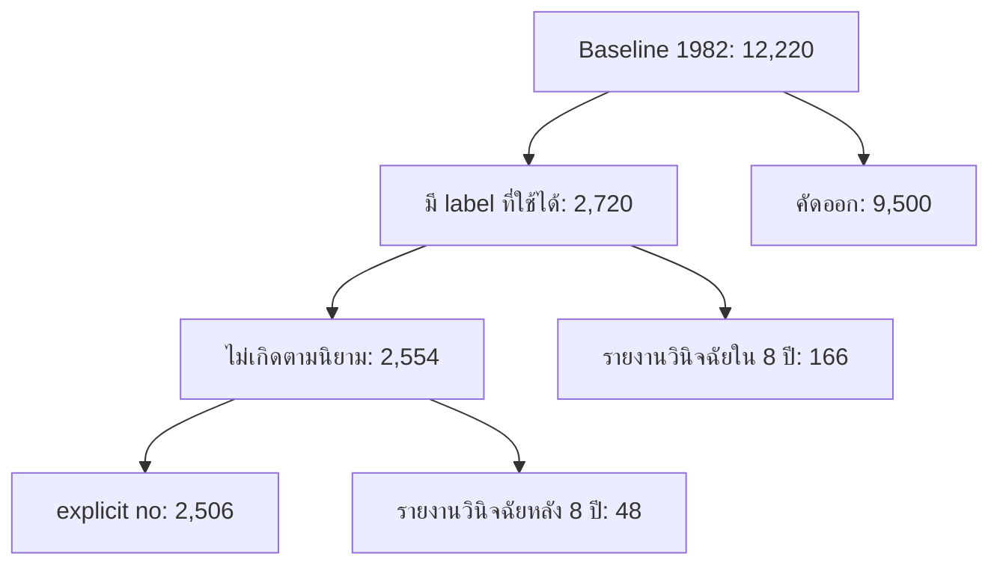

# LEPTOLIC / INT182 รอบ 3 — ตรวจหลักฐานและแผนแนวทาง 1

## ขอบเขตและสถานะ (5 พฤศจิกายน 2026)

คง NHEFS 1982–1992 และคำถามการ **รายงานว่าได้รับการวินิจฉัยครั้งแรกภายใน 8 ปี**
หลัง baseline ไม่เปลี่ยนเป็นการวัดความดัน ณ ปีที่ 8 หรือการคัดกรองปัจจุบัน
ไม่อ้างว่าเป็นความเสี่ยงรายบุคคลที่ใช้กับคนไทยได้

ตรวจ checkout `dev-by-gunner` ที่ฐาน commit `2a043922dcf327b035ee866338f98b7fd1c7b033`:
README, CODE_WALKTHROUGH, AI_DATA_SCIENCE_FUNDAMENTALS และ notebook เดิม
อ่านสกิล data-science-collaborator ที่แนบมาแล้ว ใช้แนวทางตรวจหลักฐาน แยกผลจริง/ข้อเสนอ
ไฟล์ใน ZIP มีสกิลและ assets ไม่มีข้อมูลดิบหรือสไลด์
ตรวจรายการไฟล์ของ branch `slide-figures` เพิ่มแล้ว ไม่พบ PDF/PPT/PPTX จึง **ยังไม่ได้ตรวจสไลด์**

**ผลตรวจซอฟต์แวร์ใหม่:** unit/integration tests ผ่าน 8 ข้อ และ `pip check` ผ่าน
integration test ใช้ข้อมูลแต่งสำหรับทดสอบการต่อระบบ/ส่งออก/โหลดกลับเท่านั้น
ไม่ใช่หลักฐานคุณภาพโมเดล NHEFS และไม่เก็บผลจำลองเป็นผลวิจัย
**การรัน NHEFS ใหม่:** ล้มเหลวที่ดาวน์โหลด `N82int.txt` ด้วย proxy CONNECT 403
ไม่มี metrics/model/จุดแบ่งระดับใหม่ที่ฝึกด้วยข้อมูลจริง ไม่มีการแทนข้อมูลจริงด้วยข้อมูลจำลอง

## ผลเดิมตรงกับโค้ดหรือไม่

ตัวเลขต่อไปนี้มาจาก saved outputs ของ notebook เดิม ไม่ใช่การรันยืนยันใหม่:

| รายการ | ผลบันทึก |
|---|---:|
| Baseline 1982 | 12,220 คน |
| Cohort ที่มี label | 2,720 คน |
| ไม่เกิด/เกิดเหตุการณ์ | 2,554 / 166 คน (6.10% เกิดเหตุการณ์) |
| Train / Tune / Calibration / Test | 1,495 / 408 / 408 / 409 |
| Events ในแต่ละ split | 91 / 25 / 25 / 25 |
| Ridge ที่เลือก | 10 |
| Test AUC | 0.6761458333 |
| AUC bootstrap 95% CI (เดิม 200 รอบ) | 0.56195–0.77923 |
| Brier หลัง calibration | 0.0565291855 |
| Brier ก่อน calibration | **0.0560729313** |
| Brier constant Train-prevalence baseline | 0.0573885312 |
| Threshold เดิม | 0.5 |
| TN / FP / FN / TP | 384 / 0 / 25 / 0 |

ตรวจโครงสร้าง `split_ids()` และจำนวนคน/เหตุการณ์แล้วสอดคล้องกับการแบ่งตาม class
55/15/15/15 และการปัดเศษในโค้ด ผลรวม reason counts เท่ากับ 12,220 และผลรวมเหตุผลที่รวม cohort
คือ 2,506 explicit no + 48 วินิจฉัยหลัง horizon + 166 เหตุการณ์ = 2,720

ข้อสรุป: ตัวเลขที่ผู้ใช้บอก **ตรงกับ saved outputs และสอดคล้องเชิงตรรกะกับโค้ด**
แต่ยังยืนยัน provenance ของผลหรือการฝึกซ้ำจากข้อมูลดิบไม่ได้ ทุก code cell มี execution_count เป็น null
และข้อความต้น notebook ยังระบุว่าไม่มีคะแนนจริงแนบมา ทั้งที่มี outputs อยู่แล้ว
จึงต้องเก็บ snapshot/evidence และรันใหม่ก่อนใช้เป็นผลรอบ 3

Accuracy 93.89% ไม่ใช่หลักฐานว่าคัดพบได้ดี เพราะทำนายลบทุกคนเหมือน baseline
Recall เท่ากับ 0/25 = 0% ที่ threshold 0.5 ไม่ได้แปลว่า AUC เป็นศูนย์
Precision เป็น 0/0 ซึ่ง **ไม่มีนิยาม**; ฟังก์ชันเดิมคืน 0 เพื่อหลีกเลี่ยงการหารศูนย์
workflow ใหม่รายงาน null พร้อม confusion matrix
Brier ดีกว่า constant baseline เพียงประมาณ 0.00086 หลัง calibration
ใน test ที่บันทึกไว้ calibration ทำให้ Brier และ log loss แย่ลงเล็กน้อย ไม่ควรเขียนว่า calibration ช่วยเสมอ
และไม่ควรเลือกวิธี calibration ใหม่ด้วยการดู test นี้

## ตรวจ cohort / target / คุณภาพข้อมูล

จุดอ้างอิงโค้ดอยู่ใน notebook เดิม code cell 1 (นับแบบเริ่มจาก 0):

| ฟังก์ชัน | สิ่งที่โค้ดทำ / สิ่งที่ต้องตรวจต่อ |
|---|---|
| `read_wave` | อ่าน ID แบบ string 5 หลัก ปฏิเสธ ID ซ้ำและความยาว record ผิด ตรวจ layout anchors บางตำแหน่ง |
| `prepare_cohort` | ยึด 1982 เป็นฐาน เชื่อมคนเดิมผ่าน ID ของแต่ละ wave ไม่บังคับมีข้อมูลครบทุก wave |
| `baseline_features` | อายุ 18–100, sex 1/2, SBP/DBP ใช้ summary ก่อน หรือค่าเฉลี่ยครั้ง 2/3 เมื่อครบ; OH7 จำกัด 1–24 |
| `build_label` | ต้อง D2=2 และ SBP<130/DBP<80; สร้างวันครบรอบจริงจากวันสัมภาษณ์ baseline |
| `build_label` | คัด unknown/borderline/คำตอบขัดกัน/ปีไม่สอดคล้อง/ปีทับ horizon ออก; ไม่แปลง unknown เป็น no |
| `build_label` | event อาจนับจากประวัติบวกที่ลงปีได้ แม้ต่อมาตาย/ติดตามไม่ได้; negative ต้องมีหลักฐานตามเกณฑ์ |
| `fit_preprocessor` | fit median/mean/scale เฉพาะ Train; sleep หายเติมได้ แต่ 4 ตัวหลักต้องมีเพื่อเข้า cohort |

สิ่งที่ต้องตรวจด้วยคู่มือทางการและข้อมูลจริงก่อนเปลี่ยนกฎ:

1. ความหมายรหัส HYPER, HBPYEAR1, LHIGHBP, BASERSLT, MAINRSLT และ death fields
   ของแต่ละ wave ไม่ถือว่า code ชื่อคล้ายกันมีความหมายเหมือนกัน
2. การไม่พบแถวในปี 1986 อาจเป็นเพราะกรอบอายุของ wave ไม่ใช่ loss-to-follow-up ทุกกรณี
3. กรณีข้าม HYPER เพราะเคยตอบ yes มาก่อน ต้องตรวจ skip logic กับ carry-forward
4. การวินิจฉัยปีเดียวกับ baseline ถูกคัดออกแบบ conservative และปีทับ horizon ถูกคัดออก
   เป็นแหล่ง selection/uncertainty ที่ต้องอธิบาย ไม่สร้างวันวินิจฉัยสมมติ
5. ตรวจ death-year เทียบกับ event และ explicit-no โดยเฉพาะแถวที่มีรหัสสถานะ/ประวัติขัดกัน
   ไม่สรุปว่าเป็นบั๊กแน่นอนจนตรวจคู่มือและตัวอย่างแถวได้
6. ยืนยัน OH7 ว่าตรงกับคำถามชั่วโมงนอนและ special codes ในคู่มือ; ช่วงกายภาพอย่างเดียวไม่ใช่การยืนยัน codebook
7. ทำ baseline distribution และ missingness ของ included/excluded กับแต่ละ split;
   ไม่เติม label ให้ผู้เสียชีวิต/ขาดติดตามเพื่อเพิ่ม sample
8. เช็กว่า threshold 130/80 เป็น **กฎของโครงงานสำหรับ cohort นี้** ไม่ใช่การยืนยันไม่มีโรคทางคลินิก

### Cohort flow จากผลบันทึกเดิม

เหตุผลคัดออกหลัก (เป็นลำดับ first matching reason ไม่ใช่จำนวนภาวะที่อิสระต่อกัน):
prior diagnosis/unknown 4,748; BP สูงกว่ากฎโครงงาน 2,930;
อายุ/เพศ/BP หาย 1,168; ไม่มี final surviving interview ตามกฎ 462;
เหตุผลอื่นรวม 192 ราย ข้อมูล flow นี้ยังเป็น saved outputs

## แผนที่เสนอไว้ก่อนเพิ่มโค้ด

1. เก็บ notebook เดิม ไม่แก้ target ที่ยังไม่ตรวจคู่มือ ไม่เพิ่ม BMI/อาหาร/ข้อมูลชุดใหม่จากการคาดเดา
2. ใช้ cohort และ split เดียวกัน เปรียบเทียบ A=อายุ+เพศ+SBP+DBP กับ B=A+sleep
3. Logistic Regression 5 ค่า C และ Decision Tree depth 2/3, min leaf 50 เป็นการทดลองขนาดเล็ก
   ไม่เพิ่ม Random Forest ในรอบนี้เพราะยังมีเหตุการณ์ฝึกเพียง 91 คนตาม saved output
4. เลือกจาก Tune Brier; fit preprocessing และ estimator เฉพาะ Train
   ใช้ Calibration เฉพาะ Platt ที่กำหนดไว้ล่วงหน้า และรายงานก่อน/หลังเพื่อวินิจฉัย ไม่เลือกด้วย Test
5. Threshold สำหรับ demo เลือก F2 สูงสุดจาก Tune เพื่อให้น้ำหนัก recall มากขึ้น
   เป็นทางเลือกการสาธิตที่ต้องเปิดเผย false positives ไม่ใช่ threshold ทางคลินิก
6. ระดับ 1–3 ใช้คะแนนเปอร์เซ็นไทล์ 33.3/66.7 ของ Tune หลัง calibration
   ระดับ 1/2/3 หมายถึงคะแนนสัมพัทธ์ช่วงล่าง/กลาง/บนใน cohort ไม่ใช่ปลอดภัย/ใกล้ป่วย/ป่วย
   ถ้าคะแนนซ้ำจนแบ่งไม่ได้ให้หยุด ไม่สร้าง cutoffs ปลอม
7. รายงาน AUC, average precision (AP ซึ่งเป็นสรุป PR แบบหนึ่ง), Brier, log loss,
   precision/recall/specificity/confusion matrix, bootstrap AUC/Brier, calibration bins และ event rate/CI ต่อระดับ
8. แสดง CLI และ notebook สำหรับทดลองจาก model JSON ที่ฝึกจริง ตรวจ input ranges และเกณฑ์ cohort

ข้อจำกัดการประเมิน: Test เดิมถูกเปิดเผยแล้ว จึงเรียกได้เพียงการใช้ split เดิมซ้ำเพื่อเปรียบเทียบ
ไม่ใช่ test ใหม่ที่ไม่เคยเห็นหรือ external validation ห้ามปรับโมเดลวนตาม Test
จำนวน 14 candidates และ Tune events เพียงประมาณ 25 ทำให้ selection แกว่งได้
ควรพิจารณา repeated/nested CV เฉพาะ development ในขั้นต่อไปหลังตรวจข้อมูลและล็อก protocol
ไม่อ้างว่า workflow นี้ได้ทำ CV แล้ว ไม่ใช้การเปลี่ยน seed สร้างภาพว่าได้ test ใหม่

## สิ่งที่เพิ่มและสิ่งที่ยังไม่เสร็จ

เพิ่ม `workflow.py`, `predict.py`, notebook สำหรับเรียกใช้งาน และ tests โดยไม่แก้ notebook เก่า
workflow ส่งออก data-quality summary, split manifest, test predictions, metrics,
portable model JSON และ ZIP เมื่อรันข้อมูลจริงสำเร็จ
เพิ่มการปฏิเสธ output directory ที่มีไฟล์แล้ว เพื่อไม่ปะปนผลต่างรอบ

ยังไม่มีโมเดลใหม่ที่ฝึกจริงหรือผลระดับ 1–3 ที่ยืนยันแล้ว เพราะ CDC ถูกบล็อก
ต้อง apply network access ของ `wwwn.cdc.gov` แล้วรันใหม่ และส่งสไลด์หากต้องการตรวจความสอดคล้องกับสไลด์
หลังรันสำเร็จต้องอ่าน audit/metrics/แต่ละระดับจริงก่อนส่งรายงานอาจารย์
ไม่รับประกันว่าจะได้ AUC/Recall ที่ดีขึ้นหรืออัตราเหตุการณ์แต่ละระดับเรียงตามคะแนนเสมอ

อ้างอิงทางการที่ **ยังเข้าถึงไม่ได้จาก runtime นี้**:
https://wwwn.cdc.gov/nchs/nhanes/nhefs/default.aspx
และ `1982intv.pdf`, `1986intv.pdf`, `1987intv.pdf`, `1992intv.pdf`
ใต้ https://wwwn.cdc.gov/nchs/data/nhefs/
