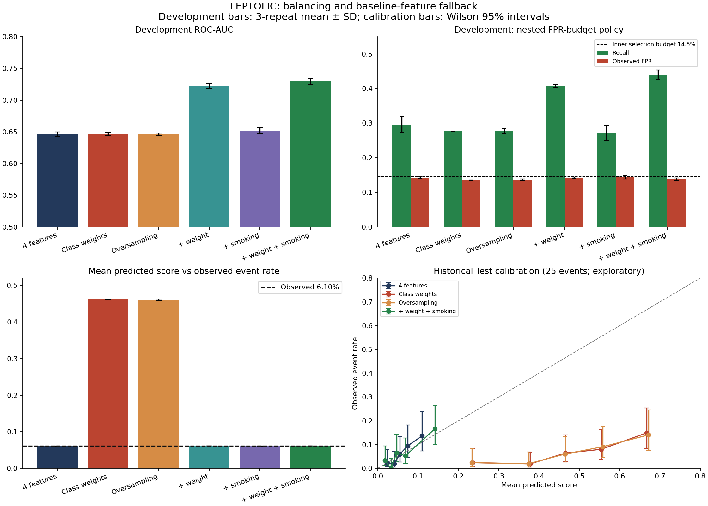

# LEPTOLIC: balancing และแผนสำรอง — ผลรันจริง 11 พฤศจิกายน 2026

**Balancing ไม่ผ่านเกณฑ์ development; แผนสำรองทำงานแล้วและเลือก +weight+smoking เป็น candidate ทดลองจาก development เท่านั้น**

โมเดลหลักและนโยบายงบ FPR 14.5% เดิมยังคงอยู่ตามเดิม การเลือก candidate นี้ไม่ใช่หลักฐานว่าดีกว่าทุกด้าน และไม่ได้เลือกใหม่จาก Test ผล Test ด้าน Brier แย่ลงเล็กน้อยและช่วงผลต่างยังคร่อมศูนย์

ดาวน์โหลดต้นฉบับ CDC ได้ในเครื่องใหม่ SHA-256 ตรงกับ 8 ไฟล์ใน ZIP รอบก่อนทั้งหมด จึงไม่ต้องใช้ ZIP แนบซ้ำสำหรับรอบนี้ ตรวจ cohort 2,720/166 events, development 2,311/141, Test 409/25; ทำนายคะแนน baseline ซ้ำตรงรอบก่อนทุกค่าถึงความละเอียดที่บันทึกไว้

## วิธีประเมิน

[Protocol ที่เขียนก่อนการเปรียบเทียบ](../../BALANCING_PROTOCOL_TH.md) · [Codebook/skip codes](../../CODEBOOK_BALANCING_TH.md) · [โค้ด](../../balancing_study.py)

ใช้ Logistic Regression C=.1 ตามโมเดลเดิม ไม่มีการค้นหา C เพิ่ม เพื่อแยกผลวิธี balancing Outer 5-fold × 3 repeats ใช้สมาชิกเดียวกันทุก variant; inner 3-fold เลือก threshold ใหม่ทุก outer fold (F2 หรือ recall ภายใต้ empirical FPR≤14.5%) ทุก preprocessing และ resampling fit เฉพาะ training ดังนั้นเป็น repeated nested **threshold** validation ไม่ใช่ nested hyperparameter search

ตาราง development ด้านล่างเป็น mean ± SD ของ **3 pooled repeats**: หนึ่งคนปรากฏหนึ่งครั้งต่อ repeat ไม่รวมซ้ำเป็น 6,933 คนอิสระ [15-fold mean/SD/min/max](outer_summary.csv) และ [ผลทุก fold](outer_folds.csv) แสดงความแปรปรวนเพิ่ม รวม calibration slope/intercept SD เหล่านี้ไม่ใช่ confidence interval ของประชากร; folds/repeats ใช้คนร่วมกัน

## 1. Probability/ranking บน development

| วิธี | ROC-AUC | Brier (ต่ำดีกว่า) | คะแนนเฉลี่ย | Calibration intercept-in-large | Calibration slope |
|---|---:|---:|---:|---:|---:|
| 4 features | 0.6463 ± 0.0038 | 0.0564 ± 0.0001 | 0.0609 ± 0.0001 | 0.0014 ± 0.0020 | 1.0025 ± 0.0294 |
| Class weights | 0.6467 ± 0.0027 | 0.2318 ± 0.0005 | 0.4618 ± 0.0003 | -2.7392 ± 0.0018 | 0.8731 ± 0.0197 |
| Oversampling | 0.6461 ± 0.0019 | 0.2316 ± 0.0008 | 0.4605 ± 0.0014 | -2.7411 ± 0.0022 | 0.8450 ± 0.0012 |
| + weight | 0.7221 ± 0.0040 | 0.0555 ± 0.0001 | 0.0611 ± 0.0002 | -0.0012 ± 0.0028 | 0.9997 ± 0.0148 |
| + smoking | 0.6519 ± 0.0051 | 0.0565 ± 0.0001 | 0.0610 ± 0.0001 | 0.0007 ± 0.0013 | 0.9305 ± 0.0407 |
| + weight + smoking | 0.7294 ± 0.0047 | 0.0555 ± 0.0001 | 0.0610 ± 0.0001 | -0.0005 ± 0.0018 | 0.9762 ± 0.0128 |

อัตราเหตุการณ์ development จริง 6.10%; balanced/oversample ให้คะแนนเฉลี่ยประมาณ 46% จึงเสีย calibration อย่างมาก คะแนนดิบหลัง balancing ไม่ใช่ความเสี่ยงที่ปรับกลับตาม prevalence แล้ว ผลนี้ไม่ใช่ข้อพิสูจน์ว่า balancing ทุกแบบร่วมกับ calibration จะไม่มีประโยชน์ รอบนี้ไม่ได้ทดลอง prior correction หรือ fitted recalibration เพิ่ม

## 2. Operating metrics บน outer validation

| วิธี | Policy | TP | FP | FN | TN | Recall % | Precision % | F2 | FPR % |
|---|---|---:|---:|---:|---:|---:|---:|---:|---:|
| 4 features | f2 | 102.0 ± 6.9 | 1204.0 ± 98.5 | 39.0 ± 6.9 | 966.0 ± 98.5 | 72.34 ± 4.91 | 7.82 ± 0.12 | 0.2726 ± 0.0036 | 55.48 ± 4.54 |
| 4 features | fpr145 | 41.7 ± 3.2 | 309.7 ± 6.4 | 99.3 ± 3.2 | 1860.3 ± 6.4 | 29.55 ± 2.28 | 11.85 ± 0.67 | 0.2275 ± 0.0157 | 14.27 ± 0.30 |
| Class weights | f2 | 100.7 ± 3.5 | 1199.3 ± 69.5 | 40.3 ± 3.5 | 970.7 ± 69.5 | 71.39 ± 2.49 | 7.75 ± 0.17 | 0.2701 ± 0.0015 | 55.27 ± 3.20 |
| Class weights | fpr145 | 39.0 ± 0.0 | 292.3 ± 2.1 | 102.0 ± 0.0 | 1877.7 ± 2.1 | 27.66 ± 0.00 | 11.77 ± 0.07 | 0.2178 ± 0.0005 | 13.47 ± 0.10 |
| Oversampling | f2 | 99.0 ± 3.6 | 1188.7 ± 58.0 | 42.0 ± 3.6 | 981.3 ± 58.0 | 70.21 ± 2.56 | 7.69 ± 0.11 | 0.2673 ± 0.0019 | 54.78 ± 2.67 |
| Oversampling | fpr145 | 39.0 ± 1.0 | 296.3 ± 4.0 | 102.0 ± 1.0 | 1873.7 ± 4.0 | 27.66 ± 0.71 | 11.63 ± 0.40 | 0.2168 ± 0.0063 | 13.66 ± 0.19 |
| + weight | f2 | 90.3 ± 2.5 | 617.0 ± 82.9 | 50.7 ± 2.5 | 1553.0 ± 82.9 | 64.07 ± 1.78 | 12.87 ± 1.30 | 0.3559 ± 0.0155 | 28.43 ± 3.82 |
| + weight | fpr145 | 57.3 ± 0.6 | 309.0 ± 4.6 | 83.7 ± 0.6 | 1861.0 ± 4.6 | 40.66 ± 0.41 | 15.65 ± 0.25 | 0.3081 ± 0.0035 | 14.24 ± 0.21 |
| + smoking | f2 | 94.7 ± 8.1 | 1035.3 ± 81.2 | 46.3 ± 8.1 | 1134.7 ± 81.2 | 67.14 ± 5.73 | 8.37 ± 0.07 | 0.2791 ± 0.0094 | 47.71 ± 3.74 |
| + smoking | fpr145 | 38.3 ± 3.1 | 312.3 ± 11.0 | 102.7 ± 3.1 | 1857.7 ± 11.0 | 27.19 ± 2.17 | 10.92 ± 0.60 | 0.2094 ± 0.0144 | 14.39 ± 0.51 |
| + weight + smoking | f2 | 89.0 ± 7.8 | 651.3 ± 28.3 | 52.0 ± 7.8 | 1518.7 ± 28.3 | 63.12 ± 5.54 | 12.01 ± 0.46 | 0.3408 ± 0.0202 | 30.02 ± 1.30 |
| + weight + smoking | fpr145 | 62.0 ± 2.0 | 300.3 ± 7.4 | 79.0 ± 2.0 | 1869.7 ± 7.4 | 43.97 ± 1.42 | 17.11 ± 0.52 | 0.3346 ± 0.0099 | 13.84 ± 0.34 |

14.5% เป็นข้อจำกัดตอนเลือก threshold จาก inner OOF ไม่รับประกัน outer/Test FPR ส่วน F2-policy ไม่มีเพดาน FP และไม่ได้ออกแบบให้ recall ต้องสูงที่สุดอย่างเดียว

## 3. แผนสำรองที่ดำเนินการจริง

- ตรวจ codebook ก่อนเพิ่มน้ำหนักวัด baseline (pounds, ไม่ใช่ BMI) และประวัติ smoking; ใช้ +weight, +smoking, +ทั้งคู่ บน cohort/folds เดิม ไม่ตัดคนที่น้ำหนักหายออก
- Weight และ weight+smoking ผ่านเกณฑ์ development ที่กำหนด; smoking เพียงอย่างเดียวไม่ผ่าน เลือก weight+smoking เพราะ mean development Brier ต่ำสุดในกลุ่มที่ผ่าน ผลต่าง Brier กับ weight-only เล็กมาก จึงไม่อ้างว่า smoking เพิ่มประโยชน์ที่ยืนยันแล้ว
- รุ่นรวมมี 6 ตัวแปรตั้งต้น และ encoded columns 9 ช่อง รวม weight-missing และ smoking category flags unknown smoking เป็นศูนย์ใน cohort นี้ จึงไม่มีข้อมูลพอเรียนผลของหมวด unknown สำหรับคนนอก cohort
- การคัดเลือกจากผล development หลาย variant ยังมี selection optimism; ตัวเลขนี้ประเมินแต่ละ fixed workflow ไม่ใช่ unbiased evaluation ของขั้นตอนเลือกผู้ชนะจากทั้งหมด ต้องประเมิน candidate ที่ freeze แล้วบนข้อมูลใหม่ก่อนอ้างความเหนือกว่า

[กติกาและผลตัดสินที่ freeze ก่อน Test](decision_before_test.json) · [พารามิเตอร์ที่ fit จริงทุก variant](candidate_models.json)

## 4. Test เดิม — exploratory เท่านั้น

| วิธี | Policy | Threshold % | TP | FP | FN | TN | Recall % | Precision % | F2 | ROC-AUC | Brier |
|---|---|---:|---:|---:|---:|---:|---:|---:|---:|---:|---:|
| 4 features | f2 | 5.954 | 16 | 143 | 9 | 241 | 64.00 | 10.06 | 0.30888 | 0.70542 | 0.05579 |
| 4 features | fpr145 | 9.286 | 8 | 42 | 17 | 342 | 32.00 | 16.00 | 0.26667 | 0.70542 | 0.05579 |
| Class weights | f2 | 51.630 | 16 | 124 | 9 | 260 | 64.00 | 11.43 | 0.33333 | 0.70917 | 0.21491 |
| Class weights | fpr145 | 62.325 | 8 | 44 | 17 | 340 | 32.00 | 15.38 | 0.26316 | 0.70917 | 0.21491 |
| Oversampling | f2 | 51.472 | 16 | 120 | 9 | 264 | 64.00 | 11.76 | 0.33898 | 0.71510 | 0.21469 |
| Oversampling | fpr145 | 62.852 | 8 | 39 | 17 | 345 | 32.00 | 17.02 | 0.27211 | 0.71510 | 0.21469 |
| + weight | f2 | 7.190 | 14 | 89 | 11 | 295 | 56.00 | 13.59 | 0.34483 | 0.69708 | 0.05710 |
| + weight | fpr145 | 9.276 | 9 | 56 | 16 | 328 | 36.00 | 13.85 | 0.27273 | 0.69708 | 0.05710 |
| + smoking | f2 | 5.387 | 21 | 165 | 4 | 219 | 84.00 | 11.29 | 0.36713 | 0.72542 | 0.05562 |
| + smoking | fpr145 | 9.477 | 10 | 49 | 15 | 335 | 40.00 | 16.95 | 0.31447 | 0.72542 | 0.05562 |
| + weight + smoking | f2 | 6.095 | 15 | 119 | 10 | 265 | 60.00 | 11.19 | 0.32051 | 0.70344 | 0.05701 |
| + weight + smoking | fpr145 | 9.459 | 13 | 52 | 12 | 332 | 52.00 | 20.00 | 0.39394 | 0.70344 | 0.05701 |

ผลต่าง candidate weight+smoking ลบ baseline 4 features ของรอบนี้ ณ FPR-policy (paired bootstrap 2,000 draws; fixed fitted models):

| Metric | 95% percentile interval |
|---|---:|
| Δrecall | [0.00000, 0.40000] |
| Δprecision | [-0.04428, 0.12317] |
| Δf2 | [-0.01866, 0.26985] |
| Δroc_auc | [-0.07500, 0.07097] |
| Δbrier | [-0.00117, 0.00339] |

ΔBrier >0 แปลว่า candidate แย่กว่า; Δrecall/F2/AUC >0 แปลว่าสูงกว่า ช่วง recall แตะศูนย์ และ F2/Brier/AUC คร่อมศูนย์ จึงยังยืนยันความเหนือกว่าไม่ได้ [CI ของทุก metric รวม TP/FP/FN/TN](test_bootstrap_ci.csv) · [paired differences ทุก variant](test_paired_difference_ci.csv)

**เหตุที่ baseline F2 ในตารางไม่ใช่ TP23/FP250 เดิม:** คะแนนโมเดลเดิมตรงกัน แต่ threshold ถูกเลือกใหม่บน OOF ของ fixed-C four-feature workflow รอบนี้ (5.954%) ต่างจาก threshold เดิม 4.17% ที่มาจาก workflow เลือกหลาย candidate ส่วน threshold FPR รอบนี้ 9.286% ให้ TP8/FP42; นโยบายที่คงใช้อยู่เดิม 9.187% ให้ TP8/FP45 ไม่มีการเขียนทับนโยบายเดิม และไม่ควรอ้างการลด FP จาก threshold ใหม่ว่า AUC ดีขึ้น

แม้ smoking-only ดูดีกว่า candidate ในบาง Test metric ก็ไม่เปลี่ยนผู้ชนะตาม Test โมเดลหลักเดิมยังอยู่; candidate ที่เลือกจาก development ถูกส่งออกเป็นงานทดลองแยกตาม protocol

## 5. Missed events และ missingness

- Baseline FPR-policy พลาด 92 จาก 141 development events ครบทั้ง 3 repeats; กลุ่มนี้มี SBP เฉลี่ย 113.34 เทียบ 122.23 ใน 35 events ที่จับได้ทุกรอบ เป็นคำอธิบาย score separation ใน cohort ไม่ใช่ความสัมพันธ์เชิงสาเหตุ
- F2-policy พลาด 18 events ทุกรอบ และจับได้ 80 events ทุกรอบ; ผลที่เหลือแกว่งตาม fold/threshold แสดงว่าไม่ควรสรุปจาก confusion matrix เดียว
- Development น้ำหนักหาย 16/2,311 (0.69%); sleep หาย 84/2,311 (3.63%); core 4 features ไม่มี missing เพราะ cohort rule คัดออกแล้ว การ impute ไม่สามารถแก้ selection bias จากผู้ถูกคัดออกได้
- ผ่าน baseline แต่ถูกคัดออกด้วย follow-up/ประวัติขัดแย้ง 654 คน มีอายุเฉลี่ย 59.53 ปี เทียบ 47.24 ใน development; 462 คนไม่มี completed surviving final interview ไม่ได้กำหนดคนเหล่านี้เป็น negative หรืออ้างอัตราเหตุการณ์ของกลุ่มที่ไม่รู้ผล

[Missed-event groups](missed_event_audit.csv) · [Missingness](missingness_audit.csv) · [เหตุผลคัดออก/รวมเข้า](exclusion_counts.json)

## กราฟ



[SVG](comparison.svg) · [Calibration bins และ Wilson CI](calibration_bins.csv)

## รันซ้ำและตรวจหลักฐาน

```bash
python -m pip install -r round3/requirements-balancing.txt
python -m unittest discover -s tests -v
OPENBLAS_NUM_THREADS=1 OMP_NUM_THREADS=1 python -m round3.balancing_study \
  --source /path/to/nhefs_source --output round3_work/balancing_new_run
# source/raw/ มี 8 ไฟล์จาก ZIP เดิม หรือให้ดาวน์โหลดจาก CDC
# การ render กราฟต้องมี matplotlib เพิ่ม
python -m round3.report_balancing --results round3_work/balancing_new_run
```

ไฟล์ source ต้องตรง hashes ก่อนจึงรันต่อ รุ่น dependencies จริงแยกใน requirements-balancing เพราะต่างจาก environment รอบก่อน แต่ refit baseline Test score ตรงเดิมทุกค่า ค่าที่บันทึกและข้อจำกัด numerical environment อยู่ใน [verification.json](verification.json)

[Software tests](software_tests.txt) · [Independent checks](independent_verification.json) · [Raw provenance/split hashes](provenance.json) · [Codebook hashes](codebook_provenance.json) · [Anonymous OOF predictions](development_oof.csv) · [Test predictions](test_scores.csv)

candidate_models.json เก็บ coefficients, imputer/scaler, class counts และ threshold สองนโยบาย นำ replay ผ่าน PortableModel ด้วย feature order ที่ระบุและ encoding ใน encode_extra ได้ **ไม่ใช้ CLI round3.predict เดิมกับ candidate 9 columns** เพราะ legacy input form ยังรองรับ schema เดิม; รอบนี้ส่งออกเพื่อวิจัยและไม่ได้เปลี่ยน inference interface ของโมเดลหลัก

## ข้อจำกัด

ข้อมูล NHEFS สหรัฐฯ ในอดีต, reported/self-or-proxy diagnosis, selected cohort ที่ SBP<130/DBP<80, เหตุการณ์น้อย, year-only timing, incomplete follow-up, ไม่มี IPCW/competing-risk correction และไม่ถ่วง survey weights Test ถูกเปิดดูหลายรอบ; bootstrap ไม่รวมความแปรปรวนจากการฝึก/เลือกโมเดล ไม่มี external หรือ Thai validation และไม่มีหลักฐานว่าใช้วินิจฉัยหรือประเมินคนไทยได้ “ไม่มีรายงานวินิจฉัยใน 8 ปี” ไม่เท่ากับ “ไม่เคยเป็นความดันสูงตลอดชีวิต”
