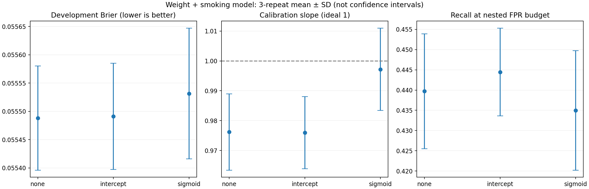

# Calibration รุ่นน้ำหนัก + ประวัติสูบบุหรี่: ผลจริง 11 พฤศจิกายน 2026

**ยังไม่มีหลักฐานจาก development ให้เพิ่ม calibration ในรุ่นทดลองนี้**

Final method: **none**; outer selections: **{'none': 15}**. กติกาเลือกวิธีพิจารณา inner Brier และเลือกวิธีง่ายกว่าหากอยู่ในช่วง one-SE; ช่วงนี้เป็น heuristic สำหรับลดความซับซ้อน ไม่ใช่ confidence interval เชิงอนุมาน

[Protocol ก่อนรัน](../../CALIBRATION_PROTOCOL_TH.md) · [โค้ด](../../calibration_study.py) · [Decision ก่อน Test](decision_before_test.json)

## ปัจจัยที่ตรวจและสิ่งที่พัฒนา

- รุ่นตั้งต้นมี calibration slope บน development ใกล้ 1 และค่าเฉลี่ยคะแนนใกล้อัตราเหตุการณ์จริงอยู่แล้ว จึงมีพื้นที่ให้ calibration เพิ่มประโยชน์ไม่มาก
- ทดลอง intercept correction เพื่อปรับระดับคะแนน และ sigmoid เพื่อปรับระดับกับความชัน ใช้พารามิเตอร์น้อย เพราะมี development events 141 คน; ไม่เลือก isotonic ที่ยืดหยุ่นมากในรอบนี้
- เพิ่มการเลือกวิธี calibration ใน inner 3-fold โดยมี calibration cross-fitting 3-fold ซ้อนใน inner training อีกชั้น ทุก preprocessing/calibrator เห็นเฉพาะ training ของตน
- ประเมินด้วย outer 5-fold × 3 repeats เดิม และเลือก F2/FPR14.5% threshold ภายใน outer training รายงาน fixed candidates และ selected workflow แยกกัน
- คง C=.1, cohort 2720/166 events, development 2311/141 และ Test 409/25 ไม่เพิ่มฟีเจอร์หรือเปลี่ยนนิยาม outcome ในรอบนี้

## Development: probability metrics

Mean ± SD ของ 3 pooled repeats; repeats/folds ไม่อิสระ ไม่ถือว่าเป็นคนเพิ่ม

| Method | ROC-AUC | Average precision | Brier ↓ | Calibration intercept-in-large (ideal 0) | Calibration slope (ideal 1) |
|---|---:|---:|---:|---:|---:|
| none | 0.72943 ± 0.00468 | 0.14256 ± 0.00236 | 0.05549 ± 0.00009 | -0.00045 ± 0.00184 | 0.97621 ± 0.01278 |
| intercept | 0.72963 ± 0.00483 | 0.14261 ± 0.00245 | 0.05549 ± 0.00009 | -0.00478 ± 0.00376 | 0.97600 ± 0.01208 |
| sigmoid | 0.72860 ± 0.00505 | 0.14145 ± 0.00242 | 0.05553 ± 0.00012 | -0.00544 ± 0.00386 | 0.99718 ± 0.01377 |
| selected | 0.72943 ± 0.00468 | 0.14256 ± 0.00236 | 0.05549 ± 0.00009 | -0.00045 ± 0.00184 | 0.97621 ± 0.01278 |

## Development: threshold policies

| Method | Policy | Recall % | Precision % | F2 | FPR % |
|---|---|---:|---:|---:|---:|
| none | f2 | 63.12057 ± 5.53918 | 12.00687 ± 0.46133 | 0.34080 ± 0.02023 | 30.01536 ± 1.30451 |
| none | fpr145 | 43.97163 ± 1.41844 | 17.11345 ± 0.51769 | 0.33464 ± 0.00985 | 13.84025 ± 0.33968 |
| intercept | f2 | 64.06619 ± 5.68852 | 11.90607 ± 0.48754 | 0.34128 ± 0.02036 | 30.76805 ± 1.70341 |
| intercept | fpr145 | 44.44444 ± 1.08335 | 16.97075 ± 0.53498 | 0.33573 ± 0.00896 | 14.13210 ± 0.25381 |
| sigmoid | f2 | 63.12057 ± 6.76553 | 12.34996 ± 0.28886 | 0.34576 ± 0.01814 | 29.10906 ± 3.02268 |
| sigmoid | fpr145 | 43.49882 ± 1.47636 | 17.05372 ± 0.61342 | 0.33202 ± 0.01151 | 13.74808 ± 0.14079 |
| selected | f2 | 63.12057 ± 5.53918 | 12.00687 ± 0.46133 | 0.34080 ± 0.02023 | 30.01536 ± 1.30451 |
| selected | fpr145 | 43.97163 ± 1.41844 | 17.11345 ± 0.51769 | 0.33464 ± 0.00985 | 13.84025 ± 0.33968 |

Sigmoid ทำให้ slope ใกล้ 1 มากขึ้น แต่ Brier ของ outer validation ไม่ลด และ budget recall ไม่ได้ดีขึ้น ส่วน intercept มีผลน้อยมาก การแก้ calibration slope เพียงค่าเดียวจึงไม่เพียงพอให้เลือกโมเดล

[TP/FP/FN/TN และ metrics ทุก repeat](repeat_metrics.csv) · [ทุก outer fold](outer_folds.csv) · [Outer mean/SD/range](outer_summary.csv)

## Final inner selection ก่อนเปิด Test

| Method | Inner mean Brier | SD across 3 folds |
|---|---:|---:|
| none | 0.05550688 | 0.00072949 |
| intercept | 0.05550256 | 0.00072047 |
| sigmoid | 0.05539629 | 0.00062457 |

Best point estimate: sigmoid; one-SE limit = 0.05575688. ผลต่างเล็กเมื่อเทียบความแกว่งระหว่าง folds จึงเลือก none ตามกติกาที่กำหนดก่อนรัน ไม่เปลี่ยนไปเลือก sigmoid เพราะผล Test ดูดีกว่า

## Historical Test: exploratory

| Method | Policy | Threshold % | TP | FP | FN | TN | Recall % | Precision % | F2 | AUC | Brier |
|---|---|---:|---:|---:|---:|---:|---:|---:|---:|---:|---:|
| none | f2 | 6.0787 | 15 | 119 | 10 | 265 | 60.00 | 11.19 | 0.320513 | 0.703438 | 0.057010 |
| none | fpr145 | 9.8034 | 10 | 49 | 15 | 335 | 40.00 | 16.95 | 0.314465 | 0.703438 | 0.057010 |
| intercept | f2 | 5.9454 | 15 | 123 | 10 | 261 | 60.00 | 10.87 | 0.315126 | 0.703438 | 0.057010 |
| intercept | fpr145 | 9.6693 | 11 | 51 | 14 | 333 | 44.00 | 17.74 | 0.339506 | 0.703438 | 0.057010 |
| sigmoid | f2 | 6.1369 | 15 | 119 | 10 | 265 | 60.00 | 11.19 | 0.320513 | 0.703438 | 0.056842 |
| sigmoid | fpr145 | 9.2247 | 13 | 52 | 12 | 332 | 52.00 | 20.00 | 0.393939 | 0.703438 | 0.056842 |
| selected | f2 | 6.0787 | 15 | 119 | 10 | 265 | 60.00 | 11.19 | 0.320513 | 0.703438 | 0.057010 |
| selected | fpr145 | 9.8034 | 10 | 49 | 15 | 335 | 40.00 | 16.95 | 0.314465 | 0.703438 | 0.057010 |

**เหตุที่ none รอบนี้จับ 10 คนแทน 13 คนของรุ่นทดลองรอบก่อน:** คะแนนของโมเดลเหมือนเดิมทุกค่า แต่ final threshold รอบนี้เลือกจาก inner 3-fold OOF ตาม protocol ใหม่; รอบก่อนเลือกจากค่าเฉลี่ย repeated outer OOF การเปลี่ยนจำนวนแจ้งเตือนนี้มาจาก threshold ไม่ใช่โมเดลเสื่อมลง ไฟล์นโยบายรอบก่อนยังอยู่ และไม่มีการเขียนทับ default

AUC ของ final models เท่ากัน เพราะ intercept/sigmoid ในรอบนี้เป็นการแปลงคะแนนที่รักษาลำดับ ส่วน pooled outer AUC อาจต่างเล็กน้อยเพราะแต่ละ fold ใช้ mapping ต่างกัน

Paired Test differences (candidate − uncalibrated, FPR-policy); Brier ต่ำกว่าดีกว่า:

| Method | Metric | 95% paired bootstrap interval |
|---|---|---:|
| intercept | recall | [0, 0.133409] |
| intercept | precision | [-0.0125203, 0.0409933] |
| intercept | f2 | [-0.00960518, 0.0919015] |
| intercept | brier | [-9.56436e-08, 1.5048e-07] |
| sigmoid | recall | [0, 0.26087] |
| sigmoid | precision | [-0.00862886, 0.0792544] |
| sigmoid | f2 | [-0.00659336, 0.179329] |
| sigmoid | brier | [-0.000383662, 2.25685e-05] |

Bootstrap 2000 draws เป็น uncertainty ของ fixed fitted models บน Test เดิม ไม่รวมความแปรปรวนการฝึกและการเลือกโมเดล [CI ทุก metric](test_bootstrap_ci.csv)

## กราฟและหลักฐาน



[Calibration bins + Wilson intervals](calibration_bins.csv) · [Parameters ทุกโมเดล](candidate_models.json) · [Final inner OOF](final_inner_oof.csv) · [Verification](independent_verification.json) · [Software tests](software_tests.txt)

## รันซ้ำ

```bash
python -m pip install -r round3/requirements-balancing.txt
OPENBLAS_NUM_THREADS=1 python -m round3.calibration_study --source /path/to/nhefs_source --output round3_work/calibration_new
# Rendering additionally requires matplotlib
python -m round3.report_calibration --results round3_work/calibration_new
```

none ในรายงานนี้หมายถึงรุ่นน้ำหนัก+สูบบุหรี่ที่ไม่ calibrate ไม่ใช่โมเดลหลัก 4 features พารามิเตอร์ replay ด้วย PortableModel และ 9 encoded columns ตามลำดับใน JSON legacy predict_file input form ยังไม่รองรับ schema นี้

## ข้อจำกัดและขั้นต่อไป

การ calibration รอบนี้ยังไม่ให้เหตุผลเพียงพอสำหรับการเปลี่ยนโมเดล แนวทางถัดไปที่มีเหตุผลคือทดลอง nonlinear effects ของอายุ/ความดัน/น้ำหนักแบบจำกัดความซับซ้อน เพื่อเพิ่มข้อมูลในการจัดลำดับคะแนน พร้อมทดสอบบนข้อมูลใหม่เมื่อหาได้ นี่เป็นข้อเสนอ ยังไม่ได้รันในงาน calibration นี้

Test เคยเปิดดูหลายครั้ง และการเลือก feature set มาจากการทดลองก่อนหน้า nested validation รอบนี้ไม่ลบประวัติ selection optimism เหล่านั้น ข้อมูลเป็น reported first diagnosis ภายใน 8 ปีใน selected historical US cohort ไม่ใช่การยืนยันโรคจากการวัด ไม่มี external/Thai validation และไม่ใช่หลักฐานว่าไม่เคยเป็นโรคตลอดชีวิต
