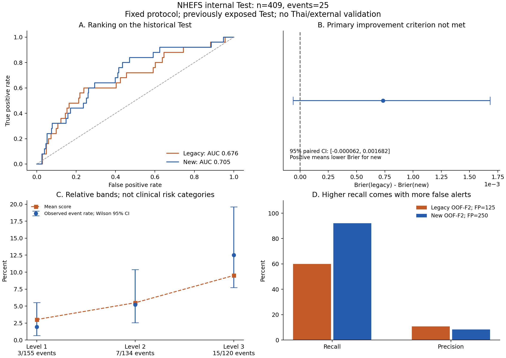

# LEPTOLIC: ผลทดลอง NHEFS จริง — 5 พฤศจิกายน 2026

## ข้อสรุปที่หลักฐานรองรับ

**รันข้อมูลจริงสำเร็จและทำซ้ำโมเดลเดิมได้ตรง แต่ยังไม่ผ่านเกณฑ์หลักที่จะยืนยันว่า Brier ดีขึ้น**

โมเดลใหม่มี Test AUC 0.7054 เทียบเดิม 0.6761 และ Brier 0.05579 เทียบเดิม 0.05653
อย่างไรก็ตาม paired-bootstrap 95% CI ของ Brier เดิมลบใหม่คือ **[-0.000062, 0.001682]**
ซึ่งคร่อมศูนย์ จึงต้องรายงานว่าหลักฐานยังไม่พอตาม primary criterion ที่กำหนดไว้ก่อนรัน
ไม่ได้เปลี่ยน seed, grid หรือเกณฑ์หลักเพื่อให้ได้คำตอบบวกหลังเห็น Test

ผลนี้เป็น internal validation ของ reported diagnosis ในประชากรสหรัฐฯ ในอดีต
Test เดิมเคยเปิดเผยแล้ว ไม่ใช่ external validation และไม่ยืนยันความเสี่ยงสำหรับคนไทย



## ข้อมูลที่ใช้และการตรวจสอบ

นำเข้า `NHEFS_compressed.zip` ที่ผู้ใช้ส่ง มีข้อมูลสัมภาษณ์ 4 รอบและ layouts ครบ 8 ไฟล์
ZIP ขนาด 10,636,034 bytes; ขนาดเมื่อคลาย 199,905,832 bytes
SHA-256: `b033492b7366a3aa7574d0b5965cc568db831263370f3dba5fff27a9066185cd`
ตรวจว่าอ่าน layouts/records ได้ครบ ไม่มี ID ซ้ำในแต่ละ wave ตาม parser และไม่มี HTML ปะปน
ที่มา CDC เป็นข้อมูลที่ผู้ส่งแจ้ง ยังไม่ได้เทียบกับ published CDC checksum โดยอิสระ
ดู [input manifest](input_archive_manifest.json) และ [data audit](data_audit.json)

| Wave | จำนวนแถว | เชื่อมกับ baseline 1982 ได้ | อยู่นอก baseline ที่ใช้ |
|---|---:|---:|---:|
| 1982–1984 | 12,220 | 12,220 | 0 |
| 1986 | 3,608 | 3,367 | 241 |
| 1987 | 9,998 | 9,309 | 689 |
| 1992 | 9,281 | 8,634 | 647 |

แถวอยู่นอก baseline ไม่ถูกนำมาต่อเป็นคนใหม่ใน cohort และไม่ถือว่าการไม่พบแถวปี 1986
เท่ากับขาดติดตามทุกกรณี เพราะการสำรวจแต่ละ wave มีขอบเขตต่างกัน

- Cohort 2,720 คน: ไม่เกิดเหตุการณ์ตามนิยาม 2,554 / เกิด 166 (6.10%)
- Development 2,311 คน / 141 เหตุการณ์; Test 409 คน / 25 เหตุการณ์
- Historical Train/Tune/Calibration/Test = 1,495/408/408/409 คน; events = 91/25/25/25
- Conservative death-year guard คัดเพิ่ม **0 คน** จึงยังเป็น cohort และ Test IDs เดิม
  ไม่ได้หมายความว่า codebook และ target ได้รับการยืนยันทั้งหมดแล้ว
- 4 baseline predictors ไม่มี missing ใน cohort; sleep หาย 96 คน (3.53%)
  แบ่งเป็น Train 57, Tune 14, Calibration 13, Test 12
- Included มี median อายุ 45 ปี เทียบ excluded 66 ปี แสดงความต่างของ cohort ที่คัดมา
  ไม่ใช่หลักฐานว่าเป็นตัวแทนประชากรทั่วไป
- อายุใน cohort 32–85 ปี จึงไม่รองรับการอ้างผลกับนักศึกษาอายุ 18–25 ปี
- Labels ใน layouts ตรงกับชื่อที่ใช้ เช่น OH7 = average hours of sleep per night และ
  NEWDODYR = year of death แต่ยังต้องยืนยันรายละเอียด value codes/skip logic จากคู่มือทางการ

## วิธีประเมินที่ล็อกไว้ก่อนเห็นผล

ใช้ [protocol เดิม](protocol.json): outer stratified 5-fold × 3 repeats, inner 3-fold
มี 20 configurations: 4/5 features × Logistic C=.1/1/10 หรือ Tree depth=2/3
× ไม่ calibration/sigmoid โดย preprocessing และ calibration อยู่ภายใน training folds
เลือกจาก mean inner Brier; ไม่ใช้ Test เลือกโมเดล threshold หรือจุดแบ่งระดับ

แต่ละ development person ได้ outer OOF scores 3 ค่า นำมาเฉลี่ยต่อคนเพื่อเลือก threshold F2
และจุดแบ่งระดับ ไม่ถือ repeats เป็นตัวอย่างอิสระเพิ่มขึ้นสามเท่า
Final model เลือกด้วย inner CV บน development แล้วจึงรายงาน Test

Legacy comparator ใช้ NumPy solver, ridge grid และ Platt split เดิม
วิธีใหม่ใช้ development มากขึ้นผ่าน cross-fitting จึงเป็นการเปรียบเทียบ **ทั้ง workflow**
ไม่สามารถสรุปว่าความต่างเกิดจากการตัด sleep หรือเปลี่ยนอัลกอริทึมเพียงอย่างเดียว

## โมเดลที่เลือก

**Logistic Regression, C=0.1, ไม่ทำ sigmoid calibration, ใช้ 4 features**:
อายุ เพศตามตัวแปรสำรวจ SBP และ DBP ไม่ใช้ sleep

Mean inner Brier ของผู้ชนะ 0.0563726 เทียบรุ่นเพิ่ม sleep ที่ดีที่สุด 0.0567930
นี่เป็นผลเลือกจาก development ไม่ใช่ข้อสรุปทั่วไปว่าการนอนไม่เกี่ยวข้องกับความดัน
ใน 15 outer fits เลือก Logistic 4 features/no calibration 9 ครั้ง,
5 features/no calibration 4 ครั้ง และ 4 features/sigmoid 2 ครั้ง ไม่มี Tree ชนะ
ดู [ทุก candidate](candidate_comparison.csv) และ [ผลราย fold](outer_fold_summary.csv)

## คะแนน Test: เปรียบเทียบบนคนชุดเดียวกัน

| Metric | Constant baseline | Legacy ที่ฝึกซ้ำ | โมเดลใหม่ |
|---|---:|---:|---:|
| ROC-AUC ↑ | 0.500000 | 0.676146 | 0.705417 |
| Average precision ↑ | 0.061125 | 0.122941 | 0.131922 |
| Brier ↓ | 0.057389 | 0.056529 | 0.055795 |
| Log loss ↓ | 0.230052 | 0.222744 | 0.216680 |

Legacy AUC และ Brier ตรงกับ saved outputs เดิมถึง tolerance 1e-14
จึงไม่ได้ใช้ตัวเลขเก่ามาแทนการฝึก comparator ใหม่

| ผลต่าง | Point estimate | Paired-bootstrap 95% CI | การตีความ |
|---|---:|---|---|
| Brier เดิม − ใหม่ (primary) | +0.000734 | [-0.000062, +0.001682] | ยังไม่ผ่านเกณฑ์หลัก |
| AUC ใหม่ − เดิม (secondary) | +0.029271 | [+0.002273, +0.061680] | สนับสนุนการจัดอันดับดีขึ้นใน Test นี้แบบ exploratory |
| AP ใหม่ − เดิม (secondary) | +0.008981 | [-0.008384, +0.034937] | ยังไม่เห็นความต่างชัดเจน |

Bootstrap สุ่มคนคู่เดียวกันให้สองโมเดล 2,000 รอบ เป็น uncertainty แบบ conditional
ต่อโมเดลที่ fit แล้ว ไม่รวม training/selection uncertainty
Secondary intervals ไม่ได้แก้ multiple comparisons และ Test มีเหตุการณ์เพียง 25 คน
จึงไม่ใช้ AUC interval มาแทน primary criterion ที่ยังไม่ผ่าน

## ความเสถียรจาก outer CV

| Metric | Legacy mean ± SD | Workflow ใหม่ mean ± SD |
|---|---:|---:|
| AUC | 0.645982 ± 0.045786 | 0.642611 ± 0.047815 |
| AP | 0.122421 ± 0.036445 | 0.119015 ± 0.038350 |
| Brier | 0.056695 ± 0.001012 | 0.056492 ± 0.001028 |
| Log loss | 0.223541 ± 0.005216 | 0.222212 ± 0.005881 |

Outer CV ไม่แสดงการเพิ่ม AUC/AP อย่างสม่ำเสมอ แม้ Test AUC เพิ่มขึ้น
Mean/SD นี้ใช้แสดงความแกว่งของ 15 folds ที่สัมพันธ์กัน ไม่ใช่ CI จาก 15 ตัวอย่างอิสระ
จึงยังสรุปว่า workflow ใหม่เหนือกว่าโดยรวมไม่ได้

## Recall และคำเตือนผิด: ต้องรายงานพร้อมกัน

| วิธี | Threshold | TP | FN | FP | TN | Recall | Precision |
|---|---:|---:|---:|---:|---:|---:|---:|
| Legacy ที่ 0.5 | 0.500000 | 0 | 25 | 0 | 384 | 0% | ไม่มีนิยาม |
| ใหม่ที่ 0.5 | 0.500000 | 0 | 25 | 0 | 384 | 0% | ไม่มีนิยาม |
| Legacy เลือก F2 จาก OOF | 0.064488 | 15 | 10 | 125 | 259 | 60% | 10.71% |
| ใหม่เลือก F2 จาก OOF | 0.041655 | 23 | 2 | 250 | 134 | 92% | 8.42% |

ภายใต้กติกาเลือก F2 แบบเดียวกัน แต่ตัวเลข threshold ต่างกัน โมเดลใหม่จับเพิ่ม 8 เหตุการณ์
พร้อม FP เพิ่ม 125 คน ส่งผลให้ 250 จาก 273 คำเตือนเป็นคนที่ไม่เกิดเหตุการณ์ตาม label
Balanced accuracy ใหม่ 0.6345 เทียบ Legacy-F2 0.6372 จึงไม่ได้ดีขึ้นทุกมิติ
Recall ใหม่ 95% Wilson CI 75.03–97.78%; Precision CI 5.68–12.32%
การเพิ่มจาก Recall 0% เป็น 92% ไม่ใช่หลักฐานว่าตัวโมเดลดีขึ้นทั้งหมด เพราะ threshold เปลี่ยนด้วย
ยังไม่เหมาะอ้างว่าเป็นเครื่องมือคัดกรองที่พร้อมใช้งานจริงโดยไม่พิจารณาต้นทุน FP

## ระดับ 1–3

จุดแบ่งจาก development OOF: 0.0437791 และ 0.0701501
ระดับ 1: score < 4.3779%; ระดับ 2: 4.3779% ≤ score < 7.0150%; ระดับ 3: score ≥ 7.0150%
เป็นช่วงคะแนนสัมพัทธ์ใน cohort ไม่ใช่ clinical cutoffs หรือเกณฑ์วินิจฉัย

| ระดับ | จำนวน Test | เหตุการณ์ | อัตราเหตุการณ์จริง | Wilson 95% CI | Mean model score |
|---|---:|---:|---:|---|---:|
| 1 | 155 | 3 | 1.94% | 0.66–5.54% | 3.02% |
| 2 | 134 | 7 | 5.22% | 2.55–10.39% | 5.49% |
| 3 | 120 | 15 | 12.50% | 7.72–19.60% | 9.51% |

อัตราเรียงตามคะแนนใน Test นี้ แต่ intervals ยังทับกันและแต่ละระดับมีเหตุการณ์น้อย
ระดับต่ำไม่ได้แปลว่าไม่มีเหตุการณ์ ส่วนระดับสูงไม่ใช่การวินิจฉัย
F2 threshold กับจุดแบ่งสามระดับมีวัตถุประสงค์ต่างกันและไม่ตรงกัน

## การตรวจซอฟต์แวร์และการรันซ้ำ

- [Software tests](software_tests.txt): 19 tests ผ่าน เป็น fixtures สำหรับตรวจ logic ไม่ใช่คะแนน NHEFS
- [Verification](verification.json): ตรวจ 409 JSON predictions ตรง stored scores ถึง 1e-12,
  ID ไม่ซ้ำ, Test/OOF ไม่ทับกัน, OOF ครบ 3 ครั้งต่อ development person
- คำนวณ AUC/AP/Brier และ paired Brier bootstrap ซ้ำแยกจาก runner ได้ตรงกัน
- [Notebook ที่รันครบ](executed_notebook.ipynb): ทุก code cell สำเร็จ และ metrics ทุกค่าตรง CLI ทุกประการ
- CLI ใช้ Python 3.12.14, NumPy 2.5.4, scikit-learn 1.7.2; ใช้ CPU/BLAS thread เดียวเพื่อทำซ้ำ
- ตรวจ source code hash และ input archive hash ได้จาก metrics/input manifest

รันใหม่จาก checkout root โดยใช้ ZIP เดิมและ work directory ใหม่:

```bash
python -m pip install -r round3/requirements.txt
OMP_NUM_THREADS=1 OPENBLAS_NUM_THREADS=1 MKL_NUM_THREADS=1 python -m round3.cv_study \
  --data-zip /path/to/NHEFS_compressed.zip --work-dir round3_work/new_attempt
```

ใน notebook กำหนด `LEPTOLIC_DATA_ZIP` หรือแก้ DATA_ZIP และกำหนด work directory ใหม่ก่อน Run all
ตัวแปร `LEPTOLIC_WORK_DIR` ใช้เลือก working output directory ได้
รันตัวอย่างสมมติด้วยโมเดลที่ฝึกจริง:

```bash
python -m round3.predict --model round3/results/nhefs_20261105/model.json \
  --input round3/results/nhefs_20261105/demo_input.json
```

ตัวอย่างอายุ 50 ปี เพศชาย SBP 120 DBP 75 ให้ score 0.0687572 และระดับ 2
เป็นตัวอย่าง input สมมติสำหรับทดสอบการใช้งาน ไม่ใช่ผลของผู้เข้าร่วมที่เปิดเผยตัวตน
โมเดลนี้ใช้ 4 features จึงไม่ใช้ sleep ที่มีในตัวอย่าง

## ไฟล์ที่เผยแพร่และข้อจำกัดที่เหลือ

- [metrics.json](metrics.json): ผลคำนวณเต็ม รวม folds, candidates, calibration bins และ intervals
- [model.json](model.json): โมเดลที่เลือกและ preprocessing parameters
- [test_pair_scores.csv](test_pair_scores.csv): label และ paired scores พร้อมลำดับแถว แทน participant IDs
  ใช้ตรวจ metric/paired bootstrap ได้โดยไม่เผยแพร่รหัสผู้เข้าร่วมต้นฉบับ
- [data_audit.json](data_audit.json), [input manifest](input_archive_manifest.json), [protocol.json](protocol.json)
- [กราฟ SVG](results_summary.svg), [PNG](results_summary.png), [รายงานอัตโนมัติ](generated_report_TH.md)

เก็บ raw survey files และไฟล์ที่มี original participant IDs ไว้ใน work directory ไม่ commit ขึ้น GitHub
รายละเอียดรหัส/skip logic, selection bias, loss to follow-up, competing events และความไม่แน่นอนของปีวินิจฉัย
ยังเป็นข้อจำกัดของข้อมูลและ target ไม่ได้หายไปเพราะ CV ผ่าน
โมเดลไม่ใช้ survey weights เพื่ออ้างความเสี่ยงประชากรประเทศ และไม่มี external/Thai validation

ขั้นพัฒนาต่อควรกำหนดต้นทุน FP/FN และทดสอบข้อมูลภายนอกหรือเพิ่มเหตุการณ์
ไม่เลือก threshold หรือเพิ่มการทดลองตาม Test นี้ซ้ำเพื่อทำให้ primary comparison ผ่าน
