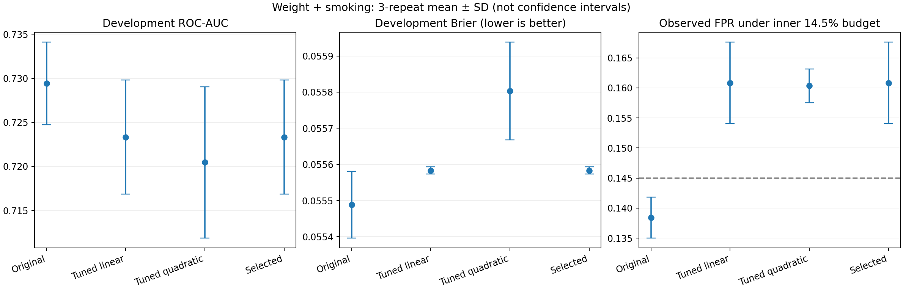

# Nonlinear Logistic ต่อรุ่นน้ำหนัก + สูบบุหรี่ — ผลจริง 11 พฤศจิกายน 2026

**การเพิ่มพจน์กำลังสองยังไม่ให้หลักฐานเพียงพอว่าดีกว่ารุ่นเดิมบน development จึงไม่แทนรุ่นเดิม**

ทดลอง Logistic Regression 6 candidates: linear/quadratic × C=.01/.1/1 ใช้ข้อมูล อายุ เพศ SBP DBP น้ำหนัก และประวัติสูบบุหรี่เดิม เพิ่มเฉพาะ squared standardized terms ของอายุ/SBP/DBP/น้ำหนัก รวม encoded terms จาก 9 เป็น 13 ไม่มี interaction, balancing หรือ calibration เพิ่มในรอบนี้

[Protocol ก่อนรัน](../../NONLINEAR_PROTOCOL_TH.md) · [โค้ด](../../nonlinear_study.py) · [Decision ก่อน Test](decision_before_test.json)

## วิธีเลือกและขอบเขตผล

Cohort 2720/166 events, development 2311/141, Test 409/25 และ split IDs/hashes เดิม Outer 5-fold × 3 repeats; inner 3-fold เลือก shape/C ด้วย Brier และ one-SE heuristic เลือก linear ก่อน quadratic และ C ต่ำก่อน C สูงเมื่ออยู่ในช่วง best+SE ทุก median/scaler/expanded scaler fit จาก training เท่านั้น เลือก thresholds F2/FPR14.5% จาก inner OOF ภายใน outer training Final method/thresholds freeze จาก development ก่อน Test

Final selected candidate: **linear:0.01**; outer choices: **{'linear:0.01': 13, 'linear:0.1': 2}**. นี่คือผลของขั้นตอนคัดเลือกที่ทดลอง ไม่ได้แปลว่าผ่านเกณฑ์ปรับปรุงหรือถูกนำมาแทนรุ่นเดิม one-SE เป็นกติกาให้ความสำคัญกับความเรียบง่าย ไม่ใช่ statistical CI

## Development probability metrics

Mean ± SD ของ 3 pooled repeats; แต่ละคนปรากฏหนึ่งครั้งต่อ repeat ไม่ถือ repeats เป็นคนเพิ่ม

| Workflow | ROC-AUC ↑ | AP ↑ | Brier ↓ | Calibration slope (ideal 1) |
|---|---:|---:|---:|---:|
| เดิม C=.1 | 0.72943 ± 0.00468 | 0.14256 ± 0.00236 | 0.05549 ± 0.00009 | 0.97621 ± 0.01278 |
| Linear เลือก C | 0.72332 ± 0.00647 | 0.13884 ± 0.00213 | 0.05558 ± 0.00001 | 1.57245 ± 0.28293 |
| Quadratic เลือก C | 0.72045 ± 0.00859 | 0.13639 ± 0.00672 | 0.05580 ± 0.00013 | 1.38811 ± 0.16598 |
| เลือกทั้งรูปแบบ/C | 0.72332 ± 0.00647 | 0.13884 ± 0.00213 | 0.05558 ± 0.00001 | 1.57245 ± 0.28293 |

## Development operating metrics

| Workflow | Policy | Recall % | Precision % | F2 | FPR % |
|---|---|---:|---:|---:|---:|
| เดิม C=.1 | f2 | 63.12057 ± 5.53918 | 12.00687 ± 0.46133 | 0.34080 ± 0.02023 | 30.01536 ± 1.30451 |
| เดิม C=.1 | fpr145 | 43.97163 ± 1.41844 | 17.11345 ± 0.51769 | 0.33464 ± 0.00985 | 13.84025 ± 0.33968 |
| Linear เลือก C | f2 | 64.53901 ± 2.83688 | 12.12947 ± 0.43477 | 0.34592 ± 0.00605 | 30.43011 ± 2.25399 |
| Linear เลือก C | fpr145 | 46.09929 ± 2.55713 | 15.69522 ± 0.18486 | 0.33216 ± 0.01231 | 16.08295 ± 0.67884 |
| Quadratic เลือก C | f2 | 62.88416 ± 6.03184 | 11.54217 ± 0.16445 | 0.33212 ± 0.01090 | 31.35177 ± 3.50392 |
| Quadratic เลือก C | fpr145 | 46.09929 ± 2.55713 | 15.73091 ± 0.52993 | 0.33255 ± 0.01537 | 16.03687 ± 0.28031 |
| เลือกทั้งรูปแบบ/C | f2 | 64.53901 ± 2.83688 | 12.12947 ± 0.43477 | 0.34592 ± 0.00605 | 30.43011 ± 2.25399 |
| เลือกทั้งรูปแบบ/C | fpr145 | 46.09929 ± 2.55713 | 15.69522 ± 0.18486 | 0.33216 ± 0.01231 | 16.08295 ± 0.67884 |

[TP/FP/FN/TN ทุก repeat](repeat_metrics.csv) · [ทุก outer fold](outer_folds.csv) · [Mean/SD/range](outer_summary.csv)

Recall ของ workflows ที่เลือก C เพิ่มเล็กน้อยพร้อม FPR ประมาณ 16% ซึ่งเกินงบ 14.5% ใน outer validation งบ 14.5% ใช้บังคับเฉพาะตอนเลือก threshold จาก inner OOF จึงไม่รับประกันค่าที่พบในชุดใหม่ ผลนี้ชี้ว่าต้องดูจำนวนคำเตือนผิดควบคู่กับ recall

## ช่องว่างชุดฝึกกับ outer validation

ค่าเฉลี่ย 15 folds; ต่างจาก pooled-repeat AUC ด้านบนเพราะวิธีรวมคะแนนต่างกัน

| Workflow | Train AUC | Validation AUC | Train Brier | Validation Brier |
|---|---:|---:|---:|---:|
| เดิม C=.1 | 0.751972 | 0.730328 | 0.054753 | 0.055488 |
| Linear เลือก C | 0.746403 | 0.725310 | 0.055210 | 0.055582 |
| Quadratic เลือก C | 0.746798 | 0.723908 | 0.055264 | 0.055803 |
| เลือกทั้งรูปแบบ/C | 0.746403 | 0.725310 | 0.055210 | 0.055582 |

ค่าชุดฝึกดีกว่า validation ทุก workflow แต่ช่องว่างอย่างเดียวไม่พิสูจน์ overfitting การเพิ่ม squares ในการทดลองนี้ไม่ได้เพิ่มความสามารถแยกกลุ่มใน outer validation regularization ที่แรงขึ้นอาจลดทั้งความแกว่งและสัญญาณที่มีประโยชน์ได้

## Final inner selection

| Candidate | Inner mean Brier | SD |
|---|---:|---:|---:|
| linear:0.01 | 0.05573488 | 0.00026024 |
| linear:0.1 | 0.05550688 | 0.00072949 |
| linear:1.0 | 0.05574122 | 0.00089579 |
| quadratic:0.01 | 0.05584271 | 0.00039389 |
| quadratic:0.1 | 0.05540154 | 0.00067727 |
| quadratic:1.0 | 0.05543874 | 0.00066059 |

Quadratic C=.1 มี inner point estimate ต่ำที่สุด แต่ linear C=.01 อยู่ในช่วง one-SE จึงถูกเลือกตามกติกาที่ตั้งไว้ก่อนรัน การเลือกนี้ไม่ได้ทำให้ outer results ดีกว่า comparator และไม่มีการเปลี่ยนกติกาหลังเห็นผล

## Test เดิม — exploratory เท่านั้น

| Workflow | Policy | Threshold % | TP | FP | FN | TN | Recall % | Precision % | F2 | AUC | Brier |
|---|---|---:|---:|---:|---:|---:|---:|---:|---:|---:|---:|
| เดิม C=.1 | f2 | 6.0787 | 15 | 119 | 10 | 265 | 60.00 | 11.19 | 0.320513 | 0.703438 | 0.057010 |
| เดิม C=.1 | fpr145 | 9.8034 | 10 | 49 | 15 | 335 | 40.00 | 16.95 | 0.314465 | 0.703438 | 0.057010 |
| Linear เลือก C | f2 | 6.5010 | 15 | 121 | 10 | 263 | 60.00 | 11.03 | 0.317797 | 0.689583 | 0.056469 |
| Linear เลือก C | fpr145 | 8.1842 | 10 | 57 | 15 | 327 | 40.00 | 14.93 | 0.299401 | 0.689583 | 0.056469 |
| Quadratic เลือก C | f2 | 6.0967 | 16 | 124 | 9 | 260 | 64.00 | 11.43 | 0.333333 | 0.712292 | 0.056642 |
| Quadratic เลือก C | fpr145 | 9.7671 | 11 | 53 | 14 | 331 | 44.00 | 17.19 | 0.335366 | 0.712292 | 0.056642 |
| เลือกทั้งรูปแบบ/C | f2 | 6.5010 | 15 | 121 | 10 | 263 | 60.00 | 11.03 | 0.317797 | 0.689583 | 0.056469 |
| เลือกทั้งรูปแบบ/C | fpr145 | 8.1842 | 10 | 57 | 15 | 327 | 40.00 | 14.93 | 0.299401 | 0.689583 | 0.056469 |

แม้ quadratic จะมี Test AUC/Brier ดีกว่า comparator ในรอบนี้ ก็ไม่เลือกย้อนหลังจาก Test ผล development ไม่สนับสนุนความเหนือกว่าอย่างสม่ำเสมอ Test มีเพียง 25 events และเคยเปิดดูหลายครั้ง จึงไม่ใช่ผลยืนยันบนชุดใหม่

ตัวเทียบ none คือรุ่น weight+smoking C=.1 จาก calibration follow-up ใช้ final threshold จาก inner OOF แบบเดียวกัน: Test TP10/FP49 ณ FPR-policy ไม่ใช่ policy รุ่นก่อนที่ใช้ mean repeated outer OOF และได้ TP13/FP52 ทั้งคะแนนและการตัดสิน baseline ในรอบนี้ตรวจตรงกับ calibration follow-up แล้ว

Paired bootstrap 2000 draws, candidate − comparator (FPR-policy):

| Workflow | Metric | 95% percentile interval |
|---|---|---:|
| Quadratic เลือก C | recall | [0, 0.125] |
| Quadratic เลือก C | precision | [-0.0219555, 0.0336399] |
| Quadratic เลือก C | f2 | [-0.0155684, 0.0829398] |
| Quadratic เลือก C | roc_auc | [-0.00329649, 0.0220247] |
| Quadratic เลือก C | brier | [-0.000740992, -9.84273e-06] |
| เลือกทั้งรูปแบบ/C | recall | [0, 0] |
| เลือกทั้งรูปแบบ/C | precision | [-0.0441473, -0.00396639] |
| เลือกทั้งรูปแบบ/C | f2 | [-0.0315847, -0.00332194] |
| เลือกทั้งรูปแบบ/C | roc_auc | [-0.0363903, 0.00940564] |
| เลือกทั้งรูปแบบ/C | brier | [-0.00204646, 0.00086154] |

ช่วงเหล่านี้ conditional on fixed fitted models ไม่รวม training/selection uncertainty [CI ทุก metrics](test_bootstrap_ci.csv) · [Calibration bins](calibration_bins.csv)

## กราฟและการทำซ้ำ



```bash
python -m pip install -r round3/requirements-balancing.txt
OPENBLAS_NUM_THREADS=1 python -m round3.nonlinear_study --source /path/to/nhefs_source --output round3_work/nonlinear_new
# Additional plotting dependency: matplotlib
python -m round3.report_nonlinear --results round3_work/nonlinear_new
```

[Software tests](software_tests.txt) · [Independent verification](independent_verification.json) · [Model parameters](candidate_models.json) · [Final inner OOF](final_inner_oof.csv) · [Provenance](provenance.json)

Parameters replay ด้วย PortableModel และ 9 encoded input columns เดิม; quadratic powers และ expanded scaler ถูกเก็บใน JSON การตีความ coefficient ของ squared term ต้องร่วมกับ linear term จึงไม่ควรใช้เครื่องหมาย coefficient ตัวเดียวอธิบายว่าเพิ่มหรือลดความเสี่ยงเสมอ

## ข้อสรุปและข้อจำกัด

ยังไม่แทนรุ่น weight+smoking C=.1 ด้วย nonlinear/selected workflow การทดลองนี้ได้ตรวจสมมติฐานเพิ่มความโค้งแล้ว แต่ไม่มีหลักฐานพอว่าดีขึ้น การลองรูปแบบเพิ่มเรื่อย ๆ บนข้อมูลเดิมอาจทำให้เลือกผลบังเอิญ งานถัดไปควรกำหนดคำถามเฉพาะ เช่น balancing ที่ threshold .5 ตามโจทย์วิชา หรือหาข้อมูลตั้งต้นเพิ่มเติมที่ยืนยันจาก codebook พร้อมหาชุดข้อมูลใหม่สำหรับตรวจสอบ

ผลใช้กับ reported first diagnosis ภายใน 8 ปีใน selected historical NHEFS US cohort ยังมี selection bias, missing follow-up, history of model selection และไม่มี external/Thai validation ไม่ใช่การวินิจฉัยจากการวัดจริงหรือหลักฐานว่าไม่เคยเป็นโรคตลอดชีวิต
