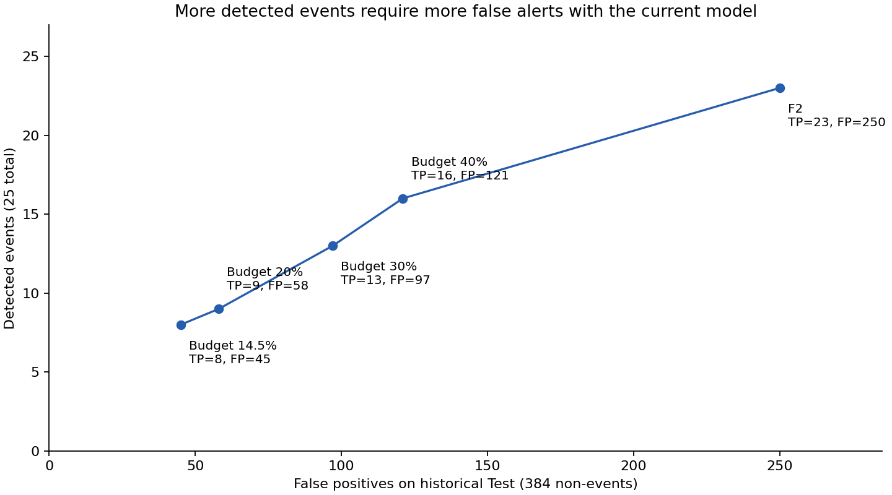

# แนวทางเพิ่มการจับเหตุการณ์: เปรียบเทียบก่อนเลือก — 10 พฤศจิกายน 2026

**โมเดลปัจจุบันจับได้มากขึ้นเมื่อยอมรับคำเตือนผิดเพิ่ม ส่วนการทดลองโมเดลภายใต้งบ 14.5% ยังไม่เพิ่ม TP บน Test**
ผู้ใช้ขอเสนอหลายระดับก่อน จึงเก็บนโยบาย 14.5% ล่าสุดเป็นค่าเดิม ไม่เลือกนโยบายใหม่แทนให้อัตโนมัติ
ข้อมูลทั้งหมดมาจาก NHEFS ที่ส่งมา: development 2,311 คน/141 events และ historical Test 409 คน/25 events

## ทางเลือกที่ 1: เพิ่มความไวด้วยงบคำเตือนผิดหลายระดับ

ใช้ probability ของโมเดลเดิมทุกแถว เลือก threshold ของแต่ละงบจาก mean repeated development OOF
ด้วย maximum recall ภายใต้ empirical FPR budget และบันทึก choices ก่อนเปิด Test predictions ใน runner
ไม่ได้เลือกจุดตัดจาก Test

| งบ FPR บน development | Probability threshold | TP / 25 | FN | FP / 384 | FPR จริงใน Test | Recall | Precision |
|---|---:|---:|---:|---:|---:|---:|---:|
| 14.5% เดิม | 9.1868% | 8 | 17 | 45 | 11.72% | 32% | 15.09% |
| 20% | 8.4889% | 9 | 16 | 58 | 15.10% | 36% | 13.43% |
| 30% | 7.2642% | 13 | 12 | 97 | 25.26% | 52% | 11.82% |
| 40% | 6.5657% | 16 | 9 | 121 | 31.51% | 64% | 11.68% |
| F2 เดิม ไม่มีเพดาน FPR | 4.1655% | 23 | 2 | 250 | 65.10% | 92% | 8.42% |



อ่านผลเพื่อพิจารณา:

- งบ 20% เทียบปัจจุบัน จับเพิ่ม 1 เหตุการณ์ แต่ FP เพิ่ม 13 คน
- งบ 30% เทียบปัจจุบัน จับเพิ่ม 5 เหตุการณ์ แต่ FP เพิ่ม 52 คน
- งบ 40% เทียบปัจจุบัน จับเพิ่ม 8 เหตุการณ์ แต่ FP เพิ่ม 76 คน
- F2 เทียบปัจจุบัน จับเพิ่ม 15 เหตุการณ์ แต่ FP เพิ่ม 205 คน

งบ FPR เป็นสัดส่วนของ non-events ไม่ใช่สัดส่วนคำเตือนที่ผิด และไม่ใช่ probability threshold
ในทุกทางเลือกยังมีคำเตือนที่ไม่เกิดเหตุการณ์ตาม label เป็นส่วนใหญ่
งบบน development ไม่รับประกันผลในประชากรใหม่; การลองหลายงบบน Test เดิมเป็น exploratory comparison
ไม่ควรใช้ตารางนี้อ้าง prospective performance หรือการใช้ทางคลินิก
AUC 0.705417 และ Brier 0.055795 เท่าเดิมทุกจุดตัด
ดู [choices ก่อนประเมิน](threshold_profile_choices.json), [ผลเต็ม](threshold_profiles.json), [ตาราง CSV](threshold_comparison.csv)

## ทางเลือกที่ 2: ปรับโมเดลเพื่อจับเหตุการณ์ที่ FPR ต่ำโดยคงงบ 14.5%

ทดลอง 9 configurations ที่ใช้ฟีเจอร์ baseline ที่ตรวจจาก layouts แล้ว:
linear Logistic 4/5 features และ quadratic Logistic 4 features แต่ละแบบมี C=.01/.1/1
quadratic เพิ่ม squared terms/interactions จากฟีเจอร์เดิม ไม่เพิ่มข้อมูลอนาคตหรือข้อมูลคนใหม่
ใช้ regularization เพราะเหตุการณ์มีน้อย และไม่ทำ calibration เพิ่มในรอบนี้

เลือกจาก mean inner standardized partial ROC-AUC ในช่วง FPR ≤14.5%
metric นี้ให้น้ำหนักช่วงที่ผู้ใช้สนใจมากกว่า AUC ทั้งเส้น แต่ไม่รับประกัน recall สูงสุดที่ทุกจุด
Outer stratified 5-fold × 3 repeats ใช้ประเมิน; inner 3-fold ใช้เลือก
การเติมข้อมูล สเกล polynomial และ threshold อยู่ใน training ของแต่ละ outer fold
threshold ภายในเลือกจาก inner OOF เท่านั้น ก่อนประเมิน outer validation

Comparator คือ Logistic 4 features C=.1 เดิม แบบ fixed configuration
แต่ threshold ของ comparator ในแต่ละ outer fit ก็เลือกจาก inner OOF ของ outer training เช่นกัน
Final candidate เลือกด้วย development ทั้งหมด ได้ **linear Logistic 4 features C=1**
quadratic และ sleep ไม่ถูกเลือก ไม่ได้สรุปว่าฟีเจอร์เหล่านี้ไม่มีประโยชน์ทั่วไป

| ผล | โมเดลปัจจุบัน งบ 14.5% | Candidate งบ 14.5% |
|---|---:|---:|
| Test threshold | 9.1868% | 9.6156% |
| Test TP / FN | 8 / 17 | 8 / 17 |
| Test FP / TN | 45 / 339 | 42 / 342 |
| Test Recall | 32% | 32% |
| Test Precision | 15.09% | 16% |
| Test AUC | 0.705417 | 0.705729 |
| Test Brier | 0.055795 | 0.055769 |

**ยังไม่พบว่าเพิ่มการจับเหตุการณ์ได้ที่งบเดิม** แม้ FP ลด 3 คนใน Test
ความต่างคะแนนเล็กมาก ยังไม่ได้มีหลักฐานเชิงยืนยันว่า candidate เหนือกว่า
final candidate threshold ใช้ inner OOF ส่วน threshold ปัจจุบันมาจาก mean repeated outer OOF
จึงเป็นการเปรียบเทียบ workflow ไม่ใช่ผล C เพียงค่าเดียว

| Outer CV mean ± SD | Fixed comparator | Candidate selection workflow |
|---|---:|---:|
| Recall | 29.52% ± 9.19% | 30.93% ± 10.74% |
| FPR | 14.27% ± 1.46% | 16.01% ± 2.67% |
| AUC | 0.648237 ± 0.043277 | 0.636759 ± 0.049034 |
| Brier | 0.056408 ± 0.001016 | 0.056604 ± 0.000965 |

Recall outer เฉลี่ยเพิ่มเล็กน้อย แต่ FPR เพิ่มและเกินงบเฉลี่ย 14.5%; AUC/Brier ไม่ดีขึ้น
จึงยังไม่แนะนำให้แทนโมเดลหลักด้วย candidate นี้
Fold/repeat สัมพันธ์กัน ค่า SD เป็นการบรรยายความแกว่ง ไม่ใช่ CI ของ independent experiments

## หลักฐานและการทำซ้ำ

- [protocol](protocol.json), [selection และ candidates](selection.json), [metrics รวม 15 outer folds](metrics.json)
- [candidate model JSON](model.json): เพื่อการตรวจทดลอง ไม่ใช่โมเดล default ที่รับรองให้ใช้แทน
- [development selection scores](development_selection_scores.csv), [paired Test scores](paired_test_scores.csv): ไม่ใช้ original participant IDs
- [software tests](software_tests.txt): 27 tests ผ่าน (25 เดิม + 2 ของการทดลองรอบนี้)
- ตรวจ linear/quadratic JSON export ให้ตรง scikit-learn; ตรวจ threshold มาจาก OOF และอยู่ใน empirical budget
- คำนวณ final development selection ซ้ำได้ตรงทั้งหมด และตรวจ JSON predictions ครบ 409 Test rows

```bash
OMP_NUM_THREADS=1 OPENBLAS_NUM_THREADS=1 MKL_NUM_THREADS=1 python -m round3.recall_study \
  --source round3_work/real_nhefs_20261105_run01 --output round3_work/recall_new_attempt
```

Runner เก็บ protocol ก่อนทดลองและ final selection ก่อน Test; CSV ใช้ลำดับแถวแทนรหัสคน
Test เคยเปิดเผยแล้วและเป็นการพัฒนาต่อเนื่อง จึงไม่มี untouched Test หรือ external validation ใหม่
ยังไม่ยืนยันกับคนไทยหรือประชากรนักศึกษา และไม่เปลี่ยนข้อสรุป primary Brier ที่ยังไม่ผ่านในรอบก่อน

## ข้อเสนอให้เลือกต่อ

หากต้องการจับมากกว่าเดิมโดยใช้โมเดลปัจจุบัน งบ 30% และ 40% เป็นทางเลือกที่เห็นผลเพิ่มใน Test นี้
ต้องเลือกระหว่างเหตุการณ์ที่พลาดกับภาระคำเตือนผิด ไม่มีจุดใดดีที่สุดโดยไม่มีต้นทุนการใช้งานกำกับ
หากต้องคงงบ 14.5% และอยากจับเพิ่มอย่างเชื่อถือได้ ควรตรวจ baseline features เพิ่มจาก codebook
และมีข้อมูล validation อีกชุด แทนการปรับตาม Test ชุดนี้ซ้ำจนได้ผลที่ต้องการ
